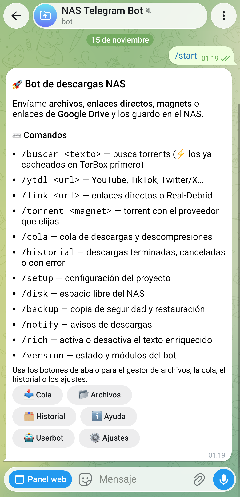
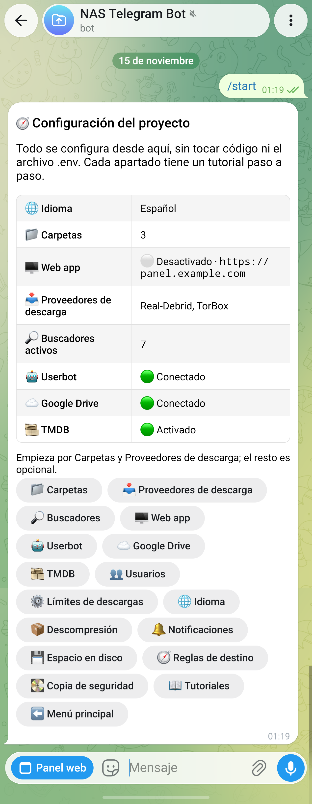
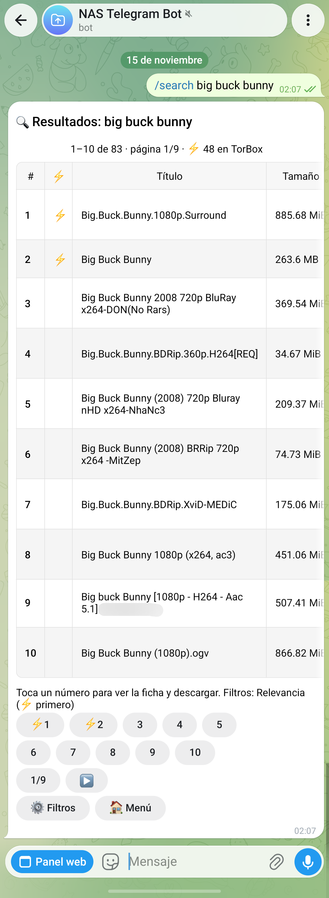
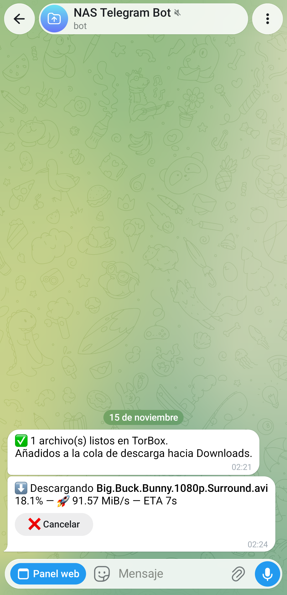
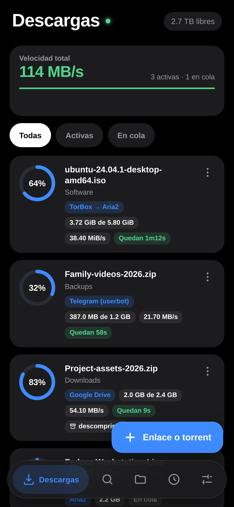
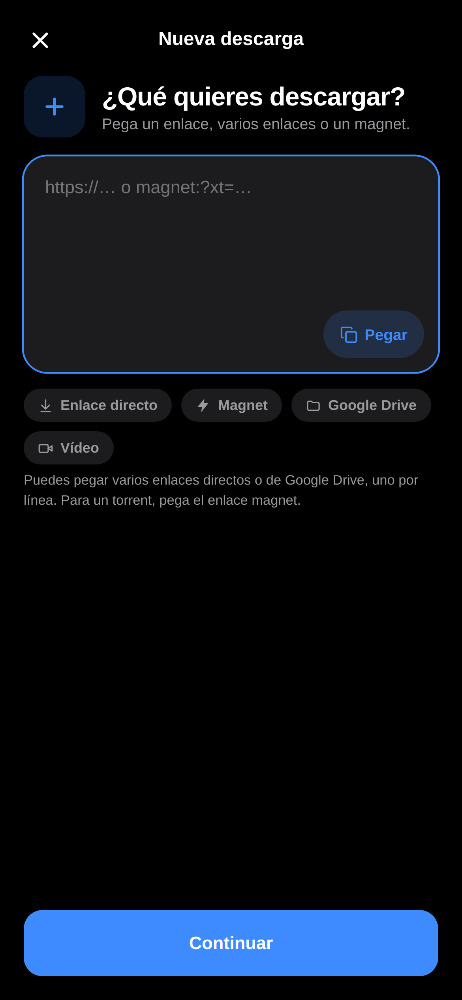
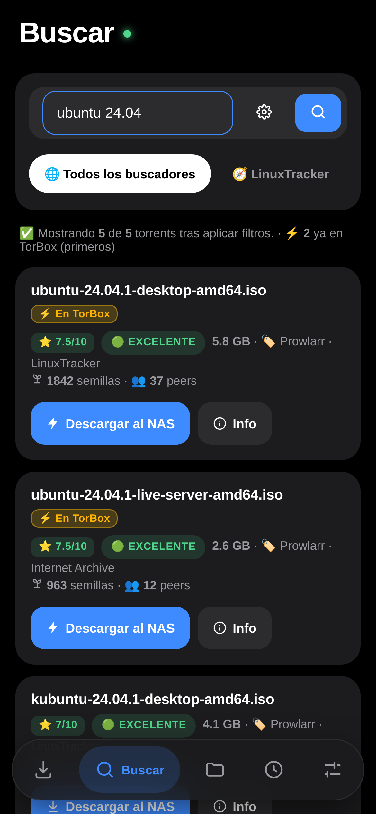
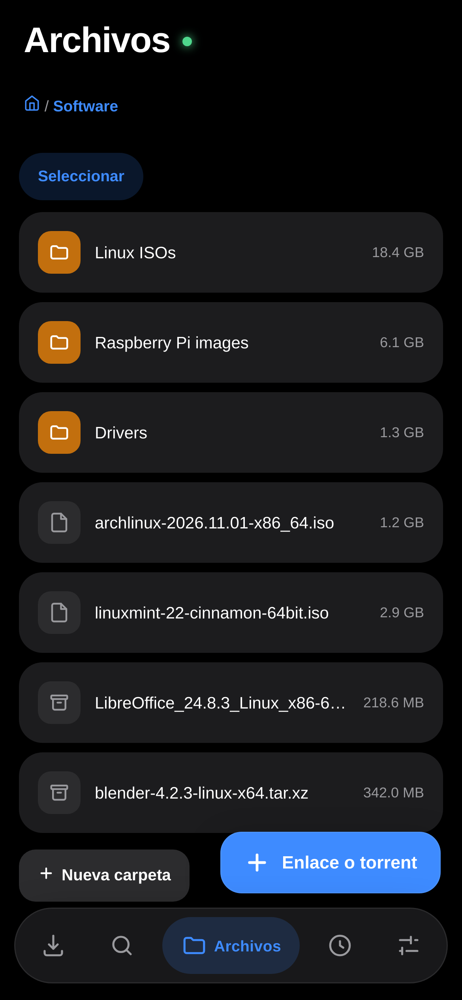
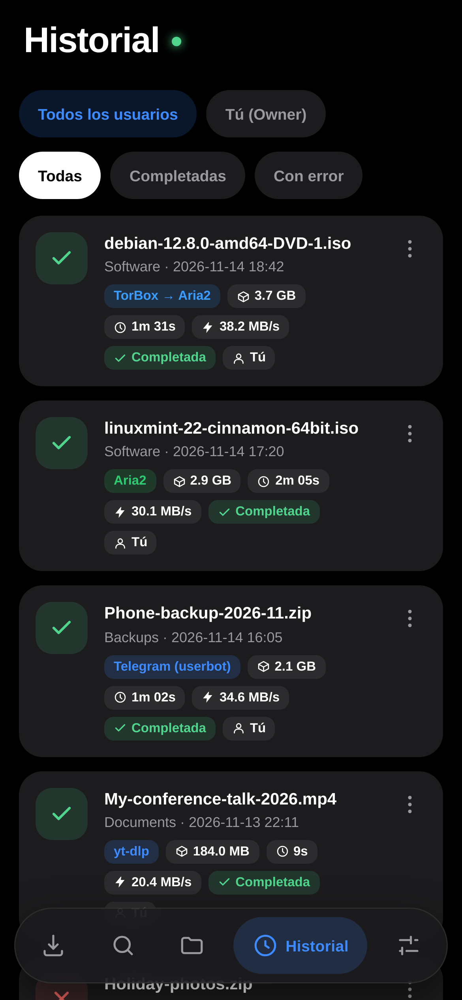
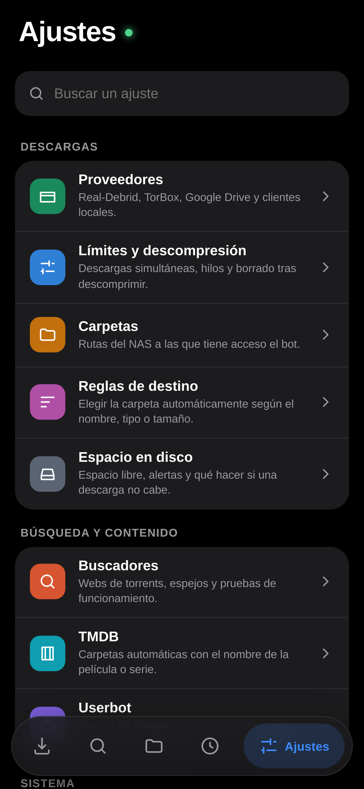

# NAS Telegram Bot

[Read in English](README.md)

Bot de Telegram autoalojado y todo en uno (con web app opcional) para descargar archivos y torrents directamente a tu NAS. Funciona en Docker y se configura por completo desde el chat.

## Índice

- [Características](#características)
- [Capturas](#capturas)
- [📘 Guías paso a paso](#-guías-paso-a-paso)
- [Inicio rápido](#inicio-rápido)
- [Modo fácil: configura todo desde Telegram](#modo-fácil-configura-todo-desde-telegram)
- [Servicios opcionales (perfiles de Docker)](#servicios-opcionales-perfiles-de-docker)
- [Variables de entorno](#variables-de-entorno)
- [Tutoriales](#tutoriales)
  - [Carpetas a las que accede el bot](#carpetas-a-las-que-accede-el-bot)
  - [Web app (Mini App de Telegram)](#web-app-mini-app-de-telegram)
  - [Túnel de Cloudflare para la web app](#túnel-de-cloudflare-para-la-web-app)
  - [Web app en tu red local (sin dominio)](#web-app-en-tu-red-local-sin-dominio)
  - [Userbot: qué es y cómo configurarlo](#userbot-qué-es-y-cómo-configurarlo)
  - [Google Drive: configurarlo desde cero](#google-drive-configurarlo-desde-cero)
  - [Real-Debrid](#real-debrid)
  - [TorBox](#torbox)
  - [qBittorrent (cliente BitTorrent local)](#qbittorrent-cliente-bittorrent-local)
  - [Transmission (cliente BitTorrent local)](#transmission-cliente-bittorrent-local)
  - [Deluge (cliente BitTorrent local)](#deluge-cliente-bittorrent-local)
  - [Buscadores de torrents](#buscadores-de-torrents)
  - [Prowlarr y FlareSolverr (opcional)](#prowlarr-y-flaresolverr-opcional)
  - [Reglas de destino](#reglas-de-destino)
  - [Copia de seguridad y restauración](#copia-de-seguridad-y-restauración)
  - [TMDB (opcional)](#tmdb-opcional)
- [Actualizar, copias de seguridad y problemas](#actualizar-copias-de-seguridad-y-problemas)
- [API externa](#api-externa)
- [Seguridad](#seguridad)
- [Hecho con Claude](#hecho-con-claude)
- [Aviso legal](#aviso-legal)
- [Licencia](#licencia)

## Capturas

### Chat

<table>
<tr><td align="center"> Menú principal</td><td align="center"> Configuración</td><td align="center"> Búsqueda de torrents</td><td align="center"> Progreso de descarga</td></tr>
</table>

### Web app

Web app (Mini App de Telegram), con datos de ejemplo. Sigue el tema claro u oscuro de Telegram ([ejemplo en claro](docs/screenshots/webapp/01-downloads-es-light.png)).

<table>
<tr><td align="center"> Descargas</td><td align="center"> Nueva descarga</td><td align="center"> Búsqueda de torrents</td></tr>
<tr><td align="center"> Gestor de archivos</td><td align="center"> Historial</td><td align="center"> Ajustes</td></tr>
</table>

## Características

- Descargas desde enlaces directos, Google Drive, YouTube y más de 1000 webs (yt-dlp), archivos de Telegram (también grandes, mediante un Userbot) y torrents.
- Proveedores de torrents a tu elección: **Real-Debrid**, **TorBox** (con caché instantánea ⚡ y gestor «Mi TorBox») y un **cliente de torrents local** (qBittorrent, Transmission o Deluge). Debido a los problemas recientes de Real-Debrid (desde mayo de 2026), ahora mismo se **recomienda TorBox**, aunque puedes usar el que prefieras.
- Enlaces: descarga directa con aria2, o mediante **Real-Debrid / TorBox** para nubes y webs que aria2 no sabe leer. Las webs de yt-dlp se tratan siempre y solo con yt-dlp.
- Buscador de torrents en varias webs con filtros (resolución, códec, idioma, fuente, puntuación de calidad). Los buscadores integrados vienen apagados para que elijas cuáles usar; añade los tuyos (Torznab / Jackett) o conecta **Prowlarr** para buscar en todos sus indexadores a la vez (solo o junto con los integrados).
- Gestor de archivos del NAS: explorar, renombrar, borrar, descomprimir y enviar a Telegram. Las descargas pueden descomprimirse solas al terminar y Ajustes → Descompresión decide si se borra después el archivo original (al descomprimir a mano nunca se borra).
- **Notificaciones** cuando una descarga termina o falla (con horas silenciosas), **control del espacio en disco** (alertas, rechazar o retener lo que no cabe) y **reglas de destino** que eligen la carpeta por nombre, tipo, tamaño, origen o usuario.
- **Copia de seguridad cifrada y restauración** de toda la configuración, desde una mínima hasta todo incluidos tokens y sesión del Userbot; manual o automática, entregada como archivo de Telegram.
- **Web app** opcional (Mini App de Telegram) con cola, buscador, archivos, historial y todos los ajustes. Todo lo que hace la web app también está en el chat.
- Interfaz completa en **inglés y español** (chat y web app).
- **Modo fácil**: tras el primer arranque, `/setup` te guía por cada conexión y token con tutoriales integrados. Sin tocar código.

## 📘 Guías paso a paso

Las guías detalladas desde cero, en español e inglés, están en [`docs/`](docs/es/README.md):

- [Instalación desde cero](docs/es/installation.md)
- [Publicar la web app: túnel de Cloudflare y alternativas](docs/es/web-app-hosting.md)
- [Google Drive desde cero](docs/es/google-drive.md)
- [Userbot desde cero](docs/es/userbot.md)
- [API REST externa](docs/es/api.md)
- [Ayuda, preguntas frecuentes y problemas](docs/es/help.md)

## Inicio rápido

1. Instala Docker y Docker Compose en tu NAS (Ugreen, Synology, QNAP, TrueNAS, una Raspberry Pi o cualquier Linux sirven).
2. Crea tu bot con [@BotFather](https://t.me/BotFather) y copia su token. Consigue tu ID numérico con [@userinfobot](https://t.me/userinfobot).
3. Descarga este repositorio y entra en la carpeta: `git clone https://github.com/JoseKill09/nas-telegram-bot.git && cd nas-telegram-bot` (o descarga el ZIP desde GitHub).
4. Copia los ajustes de ejemplo: `cp .env.example .env`, edita `.env` y rellena `BOT_TOKEN` y `OWNER_ID`. Pon en `MEDIA_ROOT` la carpeta de tu NAS que contiene tus archivos (por ejemplo `/volume1/media`). Cualquier carpeta que haya dentro se podrá añadir después desde Telegram con el nombre que quieras.
5. Arráncalo: `docker compose up -d --build`.
6. Abre tu bot en Telegram y envía `/start`. Elige idioma y abre **⚙️ Ajustes** (o envía `/setup`) para conectar el resto.

## Modo fácil: configura todo desde Telegram

Envía `/setup` (o pulsa Ajustes en el menú principal). El panel muestra el estado de cada módulo y cada uno abre una guía con su tutorial y los botones para pegar los tokens. Los valores se guardan en la base de datos dentro de `data/bot_config`, así que nunca editas código y casi todo se aplica al instante sin reiniciar:

- 🌐 Idioma · 📁 Carpetas a las que accede el bot
- 🖥 Web app on/off y su URL pública (el servidor arranca y se para en caliente)
- 🤖 Userbot (API ID/HASH, canal, login) · ☁️ Google Drive (ID/secreto de cliente, conectar)
- ⬇️ Proveedores de descarga: Real-Debrid, TorBox, qBittorrent, Transmission, Deluge
- 🔔 Notificaciones · 💾 Espacio en disco · 🧭 Reglas de destino · 💽 Copia de seguridad y restauración
- 🔎 Buscadores: activar, probar, añadir espejos, añadir nuevos, eliminar los de fábrica
- 🎬 TMDB · 👥 Usuarios autorizados

## Servicios opcionales (perfiles de Docker)

- `docker compose --profile qbittorrent up -d` (o `transmission`, `deluge`) — un cliente de torrents local listo para usar con las mismas carpetas que el bot.
- `docker compose --profile prowlarr --profile flaresolverr up -d` — Prowlarr (interfaz web en el puerto 9696) para buscar en todos sus indexadores desde el bot, más FlareSolverr para indexadores detrás de Cloudflare. Mira [Prowlarr y FlareSolverr](#prowlarr-y-flaresolverr-opcional).
- `docker compose --profile warp up -d` — proxy SOCKS5 de Cloudflare WARP (`socks5://warp:1080`) para webs de búsqueda bloqueadas por tu operador; actívalo en Ajustes → Buscadores → Salida alternativa.
- Los perfiles se pueden combinar: `docker compose --profile warp --profile qbittorrent up -d`.

## Variables de entorno

Solo `BOT_TOKEN` y `OWNER_ID` son obligatorias. El resto de `.env.example` son valores iniciales opcionales; todo lo demás se pone desde el chat.

| Variable | |
|---|---|
| `BOT_TOKEN` | Token del bot de @BotFather (obligatorio) |
| `OWNER_ID` | Tu ID de usuario de Telegram (obligatorio) |
| `TZ` | Zona horaria, p. ej. `Europe/Madrid` |
| `ARIA2_SECRET` | Secreto compartido entre el bot y aria2 |
| `MEDIA_ROOT` | Carpeta del NAS compartida con los contenedores como `/media` |
| `CLOUDFLARE_TUNNEL_TOKEN` | Opcional: token inicial del túnel (normalmente se pone desde el bot) |
| `API_TOKEN` | Opcional: activa la [API externa](docs/es/api.md) con `Authorization: Bearer` (24+ caracteres) |
| `LANGUAGE` | Opcional: `es` o `en` (vacío = preguntar en el primer `/start`) |
| `BOT_CPUS` | Opcional: núcleos de CPU máximos para el bot (2 por defecto) |
| `RICH_MESSAGES` | Opcional: `0` para usar mensajes HTML clásicos en vez de los mensajes enriquecidos de Telegram |
| `WEBAPP_ENABLED`, `WEBAPP_URL`, `API_ID`, `API_HASH`, `CHANNEL_ID`, `GOOGLE_CLIENT_ID`, `GOOGLE_CLIENT_SECRET` | Valores iniciales opcionales que también puedes poner desde el bot |

## Tutoriales

Los mismos tutoriales están dentro del bot (Ajustes → 📖 Tutoriales).

### Carpetas a las que accede el bot

El bot vive dentro de un contenedor Docker, así que solo ve lo que compartes con él. Compartes **una** carpeta de tu NAS (`MEDIA_ROOT`), que dentro de los contenedores aparece como `/media`. Cada carpeta que haya dentro se puede añadir al bot con el nombre que quieras (Música, Proyectos, Anime…), directamente desde Telegram.

1. En tu archivo `.env` pon en `MEDIA_ROOT` una carpeta real de tu NAS que contenga (o vaya a contener) tus archivos, por ejemplo `MEDIA_ROOT=/volume1/media`. Aplícalo con `docker compose up -d`.
2. En el bot abre Ajustes → Carpetas → ➕ Añadir carpeta. Recorre la carpeta compartida con los botones, pulsa **Usar esta** y escribe el nombre que quieras. También puedes pulsar **Nueva** para crear una subcarpeta en el momento.
3. Para cambiar una carpeta después, ábrela en la lista: ✏️ cámbale el nombre, 📂 apúntala a otra ruta o cambia su tipo TMDB (Películas o Series, para que TMDB cree carpetas por título).
4. Al renombrar una carpeta también se actualizan tus reglas de destino.
5. ¿Necesitas algo fuera de `MEDIA_ROOT`? Añade una línea más en `volumes:` de `docker-compose.yml` para **bot**, **aria2** (y tu cliente de torrents local), por ejemplo `- /volume1/Music:/media/Music`. Aparecerá dentro del árbol de la carpeta compartida.

> Por defecto el bot arranca con tres carpetas de ejemplo (Downloads, Movies, Series); renómbralas o quítalas con libertad.

### Web app (Mini App de Telegram)

📘 Guía completa con todas las formas de publicarla: [docs/es/web-app-hosting.md](docs/es/web-app-hosting.md)

La web app es un panel visual opcional dentro de Telegram: cola, gestor de archivos, buscador de torrents y todos los ajustes. Todo lo que hace también está en el chat, así que puedes prescindir de ella.

1. **Antes de empezar necesitas un nombre de dominio propio** (por ejemplo `ejemplo.com`). Telegram solo abre Mini Apps por una dirección **HTTPS** pública, y la forma gratuita más fácil de tenerla es un túnel de Cloudflare en un subdominio de tu dominio. Cómpralo (Cloudflare los vende a precio de coste) o usa uno que ya tengas.
2. Configura antes el túnel: Ajustes → Web app → 📖 Tutorial Cloudflare.
3. Activa la web app: Ajustes → Web app → Activar. El servidor arranca al momento, sin reiniciar.
4. Pulsa **Poner URL** y envía tu dirección HTTPS, por ejemplo `https://panel.ejemplo.com` (sin barra al final).
5. Aparece un botón **🖥️ Abrir panel web** en el menú principal (envía /start). El panel te identifica a través de Telegram: solo el propietario y los usuarios autorizados pueden usarlo.
6. Si no la quieres, déjala desactivada: el puerto 8080 queda cerrado y no se expone nada.

> No expongas el puerto 8080 directamente a internet; usa el túnel o un proxy inverso con HTTPS. Si no tienes dominio, mira las alternativas (Tailscale Funnel…) en la guía en línea.

### Túnel de Cloudflare para la web app

📘 Guía completa (dominio, túnel, nombre de host y problemas): [docs/es/web-app-hosting.md](docs/es/web-app-hosting.md#opción-a-túnel-de-cloudflare-integrado-en-el-bot-recomendada)

Un túnel de Cloudflare da a tu NAS una dirección HTTPS pública sin abrir puertos en el router. Necesitas una cuenta gratuita de Cloudflare y **un dominio propio ya añadido a Cloudflare** (con estado *Active*). Sin dominio no se puede completar esta guía.

1. Añade tu dominio a Cloudflare si aún no está: `dash.cloudflare.com` → **Add a domain**. Si lo compraste en otro sitio, cambia en tu registrador los nameservers por los dos que te indica Cloudflare y espera a que aparezca como *Active*.
2. En `dash.cloudflare.com` abre **Networking** en el menú lateral → **Tunnels** → **Create a tunnel**.
3. Escribe un nombre para el túnel (por ejemplo *nas-bot*) y continúa (**Create Tunnel**).
4. Elige **Docker** como sistema operativo. En la parte de abajo verás un comando del tipo `docker run cloudflare/cloudflared … --token eyJh…`: copia **solo el token largo que va después de** `--token`. No ejecutes el comando.
5. En el bot: Ajustes → Web app → Túnel de Cloudflare → **Poner token**, pégalo y pulsa **Iniciar**. El propio bot ejecuta el túnel (sin contenedor extra) y borra tu mensaje con el token.
6. De vuelta en Cloudflare, espera a que el túnel aparezca como conectado y pulsa **Continue**.
7. En la pestaña **Routes** pulsa **Add route** → **Published application**. Subdominio: por ejemplo `panel`; Dominio: el tuyo. En **Service URL** escribe `http://bot:8080` y guarda (**Add route**).
8. De vuelta en el bot: Ajustes → Web app → **Activar** y **Poner URL** con `https://panel.ejemplo.com` (tu subdominio y dominio).

> No pongas Cloudflare Access delante del panel: Telegram no puede mostrar su página de acceso. El túnel solo reenvía el panel web; el bot de Telegram no necesita puertos de entrada.

### Web app en tu red local (sin dominio)

Abre el panel web en cualquier navegador de tu casa sin Cloudflare ni dominio. Desde fuera de casa, conéctate a tu propia VPN (WireGuard, Tailscale…) y usa la misma dirección. Se entra con un enlace de un solo uso que envía el bot; sin contraseñas.

1. El puerto de la web app se publica en tu red desde `docker-compose.yml`: `8080` por defecto; cámbialo con `WEBAPP_LAN_PORT` en el `.env` si está ocupado.
2. En el bot: Ajustes → Web app → 🏠 Red local → ✏️ Dirección local, y envía la dirección de tu NAS con ese puerto, por ejemplo `http://192.168.1.50:8080`. Dale al NAS una IP fija en tu router para que no cambie.
3. Pulsa 🟢 **Activar**. El servidor web arranca aunque la web app de Telegram esté desactivada.
4. Pulsa 🔗 **Enviarme un enlace de acceso** (o envía `/web`). Ábrelo antes de 5 minutos en el navegador de un dispositivo de tu red: quedas dentro durante 30 días. Cada usuario autorizado puede pedir su propio enlace con `/web`.
5. Cierra sesiones en Ajustes → Web app → 🏠 Red local → 🚪 Cerrar todas las sesiones. Al desactivar el acceso también se cierran todas.
6. Instalarla como app: los navegadores solo lo permiten por **HTTPS**. Por `http://` en tu red tendrás un acceso directo en la pantalla de inicio (en iPhone se abre a pantalla completa). Para una app instalable de verdad, abre el panel con tu dominio de Cloudflare o con Tailscale (`tailscale serve`), que da HTTPS dentro de tu propia red privada.

> Cualquiera en tu wifi puede ver la página de acceso, pero sin un enlace del bot no puede entrar. No redirijas nunca un puerto del router al 8080.

### Userbot: qué es y cómo configurarlo

📘 Guía completa: [docs/es/userbot.md](docs/es/userbot.md)

Telegram limita a los bots a descargar archivos de hasta 20 MB y subir hasta 50 MB. El Userbot es una cuenta normal de Telegram (idealmente Premium) manejada por el bot mediante MTProto, lo que quita esos límites (hasta 2 GB, o 4 GB con Premium), permite enlaces de mensajes (t.me/…) y es mucho más rápido gracias a las conexiones paralelas (FastTelethon).

1. Consigue tu **API ID** y **API HASH**: entra en `my.telegram.org` con la cuenta que vas a conectar (el código llega a la app de Telegram) → API development tools → crea una aplicación (plataforma Desktop).
2. En el bot: Ajustes → Userbot → 🔑 Credenciales y canal → 🔑 API ID / HASH, y envía **los dos valores en un solo mensaje, separados por un espacio**.
3. Crea un **canal privado**. Añade a tu **bot como administrador** (con permiso para publicar) y comprueba que tu cuenta del userbot es miembro. Es el puente entre ambos.
4. Ajustes → Userbot → 🔑 Credenciales y canal → 📣 ID del canal y **reenvía al bot cualquier mensaje del canal**. Lo detecta solo (también puedes enviar el ID a mano, tipo `-1001234567890`).
5. Pulsa **🔌 Conectar nueva cuenta**, envía el teléfono con prefijo internacional (por ejemplo `+34600000000`), luego el código que te manda Telegram (si lo rechaza, escríbelo con espacios: `1 2 3 4 5`) y tu contraseña 2FA si la tienes.
6. Cómo funciona: al reenviar un archivo grande al bot, este lo copia al canal privado, el Userbot lo descarga desde ahí a máxima velocidad y lo guarda en el NAS. Para enviarte un archivo del NAS, el Userbot lo sube al canal y el bot te lo reenvía.

> La sesión se guarda solo en tu propia base de datos; nunca compartas `/config/bot.db`. Usa solo tu propia cuenta y contenido al que tengas derecho a acceder.

### Google Drive: configurarlo desde cero

📘 Guía completa paso a paso y con solución de problemas: [docs/es/google-drive.md](docs/es/google-drive.md)

Permite que el bot descargue enlaces de Google Drive directamente al NAS con tu propia cuenta de Google y tu propio proyecto de Google Cloud. Necesita la web app en línea con su URL HTTPS pública (y por tanto un dominio), porque Google te devuelve a ella cuando apruebas el acceso.

1. Comprueba que la web app está activada y tiene su URL HTTPS (Ajustes → Web app). Ajustes → Google Drive muestra tu **URI de redirección**: la URL de tu web app + `/oauth2/google/callback`.
2. Abre `console.cloud.google.com`, crea un proyecto nuevo (por ejemplo *NAS Bot*) y selecciónalo.
3. APIs y servicios → Biblioteca → busca **Google Drive API** → Habilitar.
4. Abre **Google Auth Platform** (APIs y servicios → Pantalla de consentimiento de OAuth) → Comenzar: nombre de la app y tu correo, Público **Externo**, correo de contacto, acepta y Crear.
5. Google Auth Platform → **Público** → Usuarios de prueba → Añadir usuarios: añade tu propia cuenta de Google.
6. Google Auth Platform → **Clientes** → Crear cliente → Tipo de aplicación **Aplicación web**. En **URIs de redirección autorizados** añade exactamente tu URI de redirección. Crear.
7. En el bot: Ajustes → Google Drive → 🔑 Credenciales de Google → 🔑 Client ID / secret, y envía el **ID de cliente** y el **Secreto del cliente** en **un solo mensaje, separados por un espacio**.
8. Pulsa **🔌 Conectar**, abre el enlace, elige tu cuenta, acepta el aviso de «app no verificada» (es tu propia app) y permite el acceso.

> Mientras la app está en Prueba, Google pide reconectar cada 7 días aproximadamente. Para evitarlo: Google Auth Platform → Público → Publicar aplicación, y después desconecta y vuelve a conectar.

### Real-Debrid

Real-Debrid descarga torrents y enlaces de hosters en su nube; el bot trae después los archivos a tu NAS.

1. Crea una cuenta en `real-debrid.com` con un plan premium.
2. Entra en `real-debrid.com/apitoken` y copia tu **API token**.
3. En el bot: Ajustes → Proveedores de descarga → Real-Debrid → 🔑 Configurar token, y envíalo.
4. Activa el proveedor.

> Real-Debrid no permite comprobar la caché de torrents arbitrarios, por eso el ⚡ solo aparece con TorBox.

### TorBox

TorBox descarga los torrents en su nube y luego el bot trae los archivos a tu NAS. Los torrents que ya están en la caché de TorBox se marcan con ⚡ y son instantáneos.

1. Crea una cuenta en `torbox.app` y contrata un plan.
2. Abre Settings → API en TorBox y copia tu **API key**.
3. En el bot: Ajustes → Proveedores de descarga → TorBox → 🔑 Configurar token, y envía la clave.
4. Activa el proveedor. Los resultados de búsqueda se comprobarán contra la caché de TorBox.

> Tu clave se guarda en la base de datos del bot y solo se envía a TorBox.

### qBittorrent (cliente BitTorrent local)

Con qBittorrent el torrent se descarga directamente en tu NAS con tu propia conexión, sin servicios debrid. El bot habla con qBittorrent a través de su API Web UI.

1. Arranca el contenedor incluido: `docker compose --profile qbittorrent up -d`. Monta las mismas carpetas que el bot, así las rutas coinciden.
2. Abre `http://IP_DEL_NAS:8081`. El primer acceso es `admin` y una contraseña temporal que sale en los logs (`docker compose logs qbittorrent`). Cámbiala en Herramientas → Opciones → Web UI.
3. En el bot abre Ajustes → Proveedores de descarga → qBittorrent. Pon la URL (por defecto `http://qbittorrent:8081`), el usuario y la contraseña, y pulsa **Probar**.
4. Activa el proveedor. Al enviar un magnet lo elegirás en la lista de proveedores, marcarás los archivos y la carpeta destino.
5. ¿Ya tienes un qBittorrent propio? Solo introduce su URL y credenciales, y asegúrate de que ve las mismas carpetas con las mismas rutas (las rutas `/media/...`).

> La opción «seguir sembrando» decide si los torrents terminados se quedan en qBittorrent o se quitan (los archivos siempre se conservan).

### Transmission (cliente BitTorrent local)

Transmission descarga el torrent directamente en tu NAS con tu propia conexión. El bot lo controla en remoto, elige los archivos y los deja en la carpeta que elijas.

1. Arranca el contenedor incluido: `docker compose --profile transmission up -d`. Monta las mismas carpetas que el bot, así las rutas coinciden.
2. Abre `http://IP_DEL_NAS:9091`. En el contenedor incluido el RPC no tiene login por defecto; para protegerlo define `USER` y `PASS` en el servicio del compose.
3. En el bot abre Ajustes → Proveedores de descarga → Transmission. Pon la URL (por defecto `http://transmission:9091`), el usuario y la contraseña (déjalos vacíos si no hay login) y pulsa **Probar**.
4. Activa el proveedor. Al enviar un magnet lo elegirás en la lista de proveedores, marcarás los archivos y la carpeta destino.
5. ¿Ya tienes un Transmission propio? Introduce su URL y asegúrate de que ve las mismas carpetas con las mismas rutas (las rutas `/media/...`).

> La opción «seguir sembrando» decide si los torrents terminados se quedan en Transmission o se quitan (los archivos siempre se conservan).

### Deluge (cliente BitTorrent local)

Deluge descarga el torrent directamente en tu NAS con tu propia conexión. El bot lo controla en remoto, elige los archivos y los deja en la carpeta que elijas.

1. Arranca el contenedor incluido: `docker compose --profile deluge up -d`. Monta las mismas carpetas que el bot, así las rutas coinciden.
2. Abre `http://IP_DEL_NAS:8112`. La contraseña por defecto de la Web UI es `deluge`; cámbiala en Preferencias → Interfaz. Comprueba que la Web UI está conectada al daemon (Gestor de conexiones).
3. En el bot abre Ajustes → Proveedores de descarga → Deluge. Pon la URL (por defecto `http://deluge:8112`) y la contraseña de la Web UI (Deluge no usa usuario) y pulsa **Probar**.
4. Activa el proveedor. Al enviar un magnet lo elegirás en la lista de proveedores, marcarás los archivos y la carpeta destino.
5. ¿Ya tienes un Deluge propio? Introduce su URL y asegúrate de que ve las mismas carpetas con las mismas rutas (las rutas `/media/...`).

> La opción «seguir sembrando» decide si los torrents terminados se quedan en Deluge o se quitan (los archivos siempre se conservan).

### Buscadores de torrents

El bot busca en varias webs de torrents a la vez. **Todos los buscadores incluidos vienen apagados**: tú decides cuáles usar. Cada buscador tiene una URL principal y espejos de respaldo; si la principal falla, prueba los espejos y recuerda el que funcionó.

1. Abre Ajustes → 🔎 Buscadores y activa los que quieras. Toca uno para activarlo o desactivarlo, probarlo o añadir tus propios espejos (una URL por línea).
2. Elimina un buscador de fábrica con **Eliminar buscador**; puedes recuperar los eliminados con **Restaurar de fábrica**.
3. Añade uno nuevo con **Añadir buscador**. Tipos admitidos: **Torznab** (Jackett, Prowlarr o cualquier indexador Torznab: URL + API key) y **Espejo de una web incluida**.
4. Pulsa **Probar todos** para ver cuáles funcionan desde tu red; desactiva los que fallen.
5. Si tu operador bloquea una web, usa Ajustes → Buscadores → Salida alternativa para pasar las peticiones por un proxy.

> Los espejos de fábrica están escritos de memoria y pueden estar caídos u obsoletos: añade los que te funcionen.

### Prowlarr y FlareSolverr (opcional)

Prowlarr gestiona indexadores de torrents en un solo sitio. Conéctalo y el bot buscará en todos sus indexadores con una sola consulta, solo o junto con los buscadores integrados. FlareSolverr permite a Prowlarr abrir indexadores protegidos por Cloudflare.

1. Arranca los contenedores incluidos: `docker compose --profile prowlarr --profile flaresolverr up -d`. ¿Ya tienes un Prowlarr? Sáltate este paso y usa su URL.
2. Abre `http://IP_DEL_NAS:9696`. La primera vez Prowlarr te pide crear un usuario y una contraseña (método de autenticación **Forms**).
3. Opcional, para webs detrás de Cloudflare: Prowlarr → Settings → Indexers → **Indexer Proxies** → ➕ **FlareSolverr**. Host `http://flaresolverr:8191` y una etiqueta (tag) como `flaresolverr`. Después pon esa etiqueta a los indexadores que la necesiten.
4. Prowlarr → Indexers → **Add Indexer**: añade los indexadores que quieras y pulsa Test en cada uno.
5. Copia la **API Key**: Prowlarr → Settings → General → Security.
6. En el bot: Ajustes → 🔎 Buscadores → 🧭 Prowlarr → 🔗 URL (`http://prowlarr:9696`) y 🔑 API key. El bot prueba la conexión solo y te dice cuántos indexadores ve.
7. Elige el 🔀 **Modo de búsqueda**: **Prowlarr** (solo Prowlarr) o **Ambos** (Prowlarr + los buscadores integrados que hayas activado).

> En la web app cada indexador de Prowlarr aparece como un filtro. Si Prowlarr no responde, el bot te avisa y te ofrece buscar con los integrados. La API key nunca sale de tu servidor.

### Reglas de destino

Las reglas eligen la carpeta destino de una descarga según el nombre, tipo, tamaño, origen o quién la pide, para no tener que elegir la carpeta cada vez.

1. Lo más rápido: Ajustes → Reglas de destino → ✨ Regla rápida. Escribe una palabra o frase (por ejemplo *Ubuntu*) y elige una carpeta: desde entonces, cualquier archivo cuyo nombre la contenga irá ahí. Luego activa el modo **Automático** para que se aplique sin preguntar. La web app tiene la misma tarjeta de Regla rápida.
2. Para algo más fino: ➕ Nueva regla y ponle un nombre.
3. Define las condiciones: palabras que contiene el nombre, palabras a excluir, extensiones, tipos de archivo (vídeo, audio…), rango de tamaño, origen (Telegram, enlace, torrent…), episodio de serie sí/no, una regex o IDs concretos de usuarios de Telegram. Las condiciones vacías se ignoran; todas las rellenas deben cumplirse.
4. Elige la carpeta destino y, si quieres, una subcarpeta con plantillas como `{year}`, `{month}`, `{day}`, `{ext}`, `{user}`, `{name}` o `{first}` (por ejemplo `Fotos/{year}/{month}`).
5. Elige qué hacer con los comprimidos: preguntar, descomprimir o dejarlos.
6. Las reglas se revisan en orden; usa ⬆️ ⬇️ para reordenarlas. «Parar al coincidir» decide si las siguientes también pueden coincidir.
7. Modo: **Sugerir** añade un botón ⭐ con la carpeta; **Automático** la aplica sin preguntar; **Desactivado** ignora las reglas. También puedes fijar una carpeta por defecto y qué hacer si coinciden varias.
8. Con 🧪 Probar nombre compruebas qué regla atraparía un archivo.

> Las reglas se incluyen en las copias de seguridad.

### Copia de seguridad y restauración

Guarda tu configuración en un archivo cifrado y restáurala en esta u otra instalación.

1. Abre Ajustes → Copia de seguridad (o envía `/backup`) y elige qué incluir: ajustes generales, carpetas, buscadores, reglas, usuarios, historial, índice del canal, tokens y sesión del Userbot.
2. Preajustes: **Mínima**, **Estándar** o **Todo** (incluye tokens y la sesión del Userbot, así una instalación nueva funciona al instante).
3. Todas las copias van **cifradas**. Por defecto con una **clave automática**: pulsa 🔑 Ver clave y guárdala en un gestor de contraseñas, porque la necesitas para restaurar en otra instalación. Si lo prefieres, cambia a 🔒 **Contraseña propia**.
4. Pulsa 📤 Crear copia ahora: el archivo llega al chat. Con ⏰ Automática también puedes recibir una copia diaria o semanal.
5. Para restaurar, pulsa 📥 Restaurar, envía el archivo (y la clave o contraseña si te la pide), marca los grupos y confirma. Antes se guarda una copia de seguridad de lo actual en `/config/backups`.
6. Tras restaurar tokens, la sesión del Userbot o los usuarios, reinicia el contenedor.

> Desde Telegram se pueden restaurar archivos de hasta 20 MB; la web app no tiene ese límite.

### TMDB (opcional)

Si lo activas, las descargas enviadas a la raíz de una carpeta marcada como Películas o Series se guardan en una carpeta con el nombre del título.

1. Crea una cuenta gratuita en `themoviedb.org`.
2. Ve a los ajustes de tu cuenta → **API** y solicita una clave de API (tipo Developer, rellena el formulario corto).
3. Copia la **API Key** (la corta, de 32 caracteres). No el «API Read Access Token» largo: el bot no lo usa.
4. En el bot: Ajustes → TMDB → 🔑 Configurar token, envía la clave y actívalo.
5. Marca tus carpetas como Películas o Series en Ajustes → Carpetas.

> TMDB solo se usa para nombrar carpetas; los archivos nunca se renombran.

## Actualizar, copias de seguridad y problemas

- **Actualizar:** `git pull` (o sustituye los archivos) y `docker compose up -d --build`. Tus ajustes viven en `data/bot_config` y se conservan.
- **Copia de seguridad:** usa `/backup` (Ajustes → Copia de seguridad) para un archivo cifrado, o copia la carpeta `data/`. `data/bot_config/bot.db` contiene todos los tokens y ajustes, trátala como un secreto.
- **Logs:** `docker logs -f nas-telegram-bot`.
- **Más problemas y preguntas frecuentes:** [docs/es/help.md](docs/es/help.md).
- **El bot no responde:** revisa `BOT_TOKEN` y `OWNER_ID` en `.env` y luego los logs.
- **Los archivos acaban en otro sitio o no se pueden escribir:** la carpeta debe estar montada en `docker-compose.yml` en `bot` y `aria2` con la misma ruta de contenedor y tener permiso de escritura. Ajustes → Carpetas muestra ✅ / ❌ de cada una.
- **Un buscador no devuelve nada:** Ajustes → Buscadores → Probar todos. Las webs cambian de dominio a menudo; añade un espejo que funcione o usa la salida por proxy.

## API externa

El bot ofrece una API REST (la misma que usa la web app). Está ahí por si quieres conectar el proyecto con una app o un servicio externo, o simplemente sacarle todavía más provecho: tu propia app de móvil, un panel, Home Assistant, n8n, scripts… Pon `API_TOKEN` en el `.env` y llámala con `Authorization: Bearer <API_TOKEN>`. Referencia interactiva en `/docs`. Guía completa con ejemplos: [docs/es/api.md](docs/es/api.md).

## Seguridad

- Recomendado: restringe quién puede usar el bot a nivel de Telegram. Abre [@BotFather](https://t.me/BotFather) → tu bot → **Bot Settings** → **Access** → **Restrict bot usage**. Con la opción activada, solo tú y los usuarios que elijas podréis interactuar con el bot, así que las personas no autorizadas ni siquiera podrán iniciar ni abrir el chat. Es una capa extra: el propio bot ya ignora a cualquiera que no sea el propietario o un usuario autorizado.
- Solo el propietario y los usuarios que él autorice pueden usar el bot y la web app (la web app valida las firmas de Telegram).
- No publiques nunca tu `.env` ni la carpeta `data/`: contienen tus tokens y la sesión de Telegram.
- No expongas el puerto 8080 directamente a internet; usa el túnel de Cloudflare o un proxy inverso con HTTPS.
- El `API_TOKEN` opcional da acceso total de propietario: que sea largo y secreto, o déjalo vacío.

## Hecho con Claude

**Todo este repositorio (el bot, la web app, los tests y cada línea de la documentación en español e inglés) se ha escrito con [Claude](https://claude.ai), el asistente de IA de Anthropic**, trabajando a través de [Claude Code](https://claude.com/claude-code). Durante su desarrollo se usó Claude Sonnet 5.5 (`claude-sonnet-5-5`), y esta versión pública (21.0) se preparó con **Claude Opus 5.5** (`claude-opus-5-5`) y **Claude Sonnet 5.5** (`claude-sonnet-5-5`). Una persona lo diseñó, lo probó en un NAS real y decidió cada función; Claude escribió el código.

Si tienes cualquier duda, quieres adaptarlo a tu NAS o te atascas en algún paso, puedes simplemente pedirle a un modelo de IA como Claude que te guíe o que lo haga contigo: pega la guía y tu error, o deja que un agente como Claude Code lea este repositorio. Eso sí, no pegues nunca tus tokens reales ni tu `.env`. Más en [Ayuda](docs/es/help.md#pregúntale-a-un-asistente-de-ia).

El código se comparte tal cual: revísalo antes de ejecutarlo en tu NAS e informa de cualquier problema que encuentres.

## Aviso legal

Este programa es un gestor de descargas. No aloja, indexa ni distribuye ningún contenido. Tú eres el único responsable de lo que descargas y de cumplir las leyes de derechos de autor y las condiciones de uso de Telegram, Google, tu proveedor debrid y cada web que conectes. Usar una cuenta de usuario de Telegram a través de la API (Userbot) es decisión y responsabilidad tuya.

## Licencia

[MIT](LICENSE).
