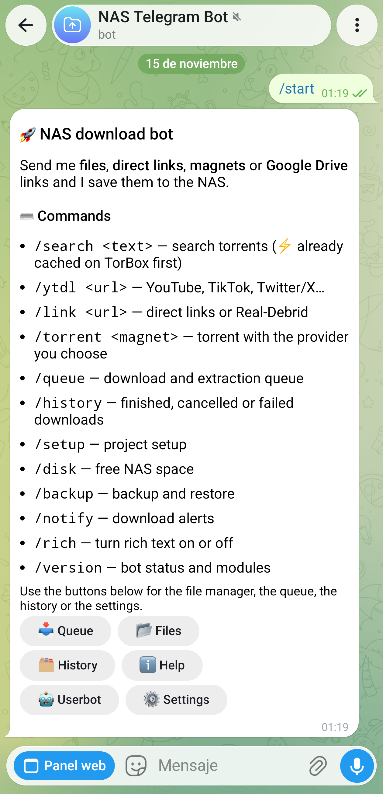
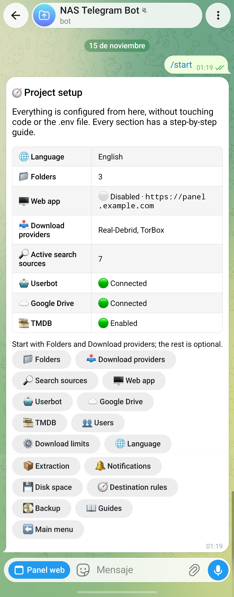
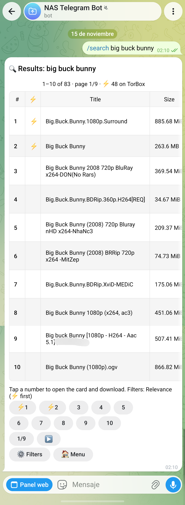
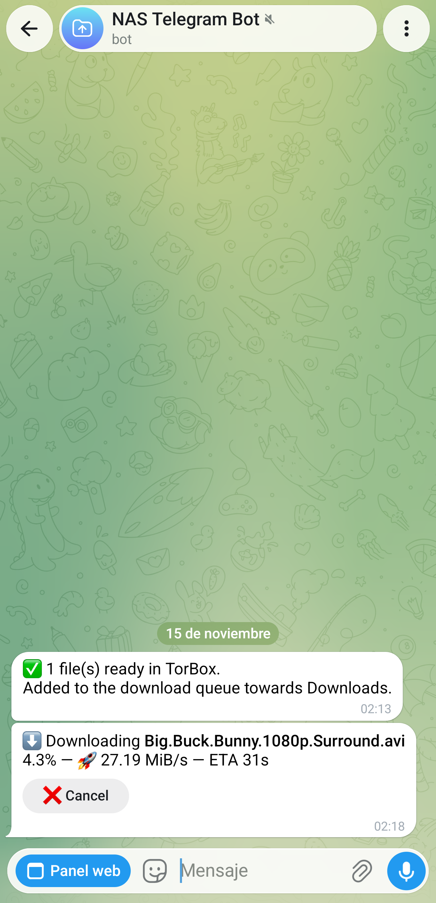
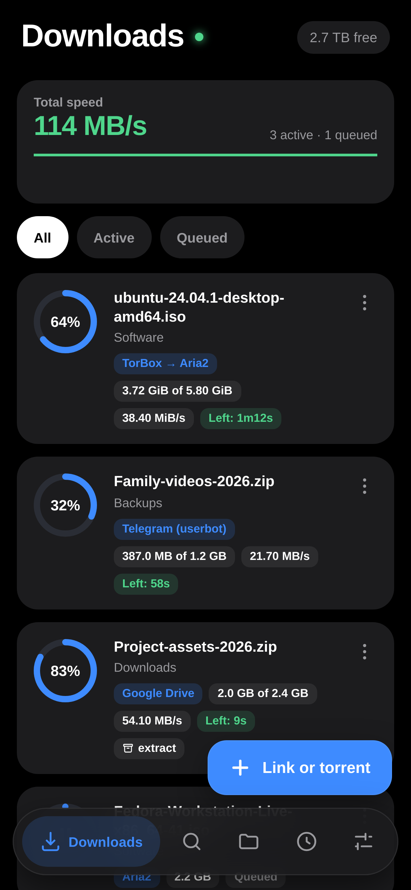
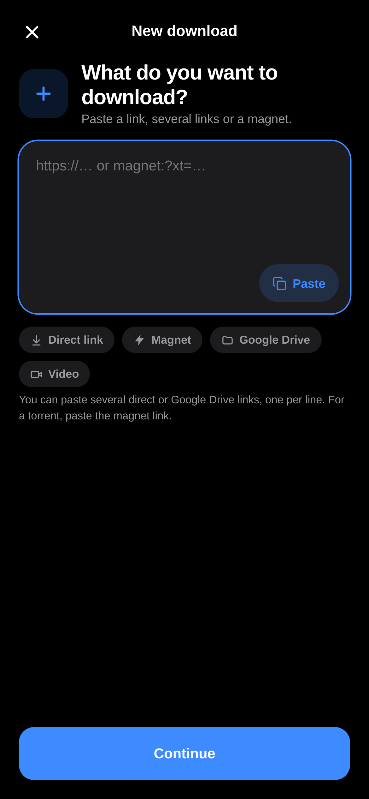
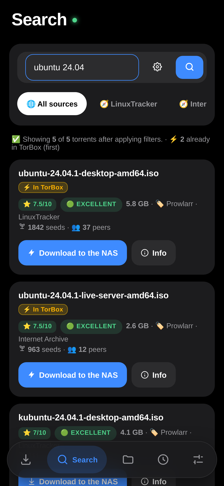
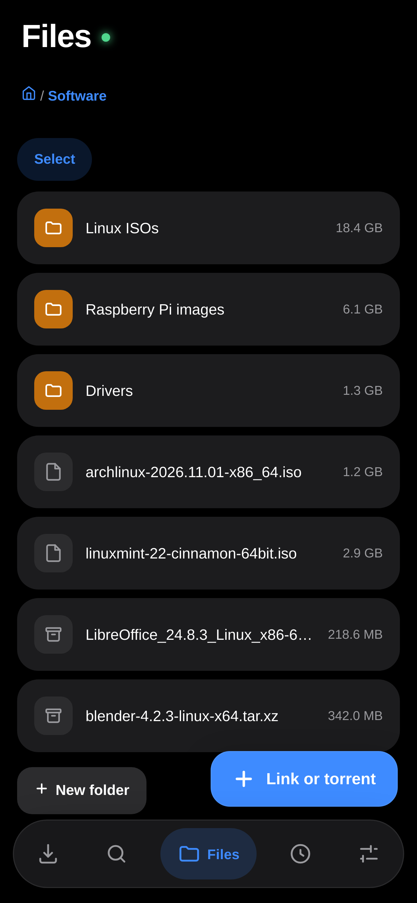
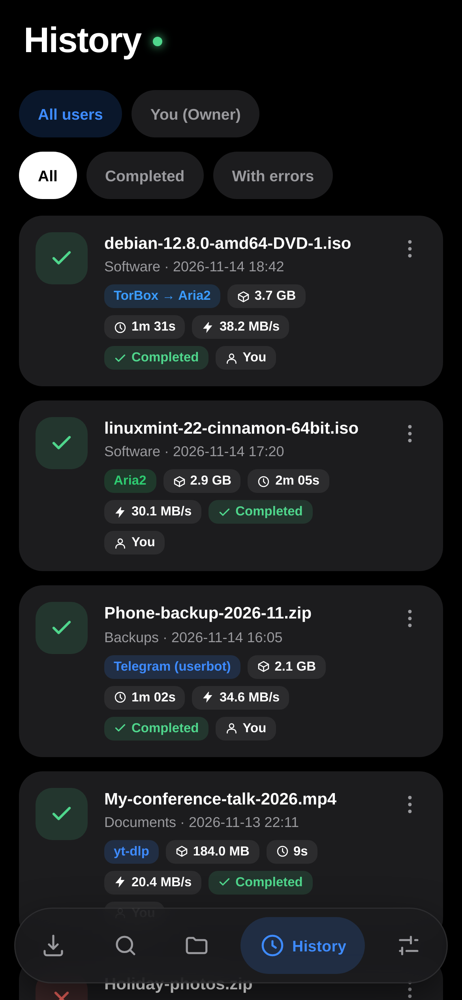
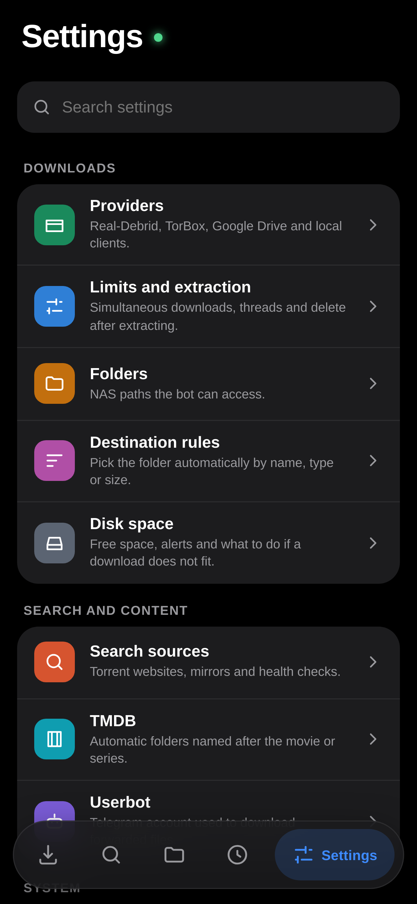

# NAS Telegram Bot

[Leer en español](README.es.md)

A self-hosted, all-in-one Telegram bot (with an optional web app) to download files and torrents straight to your NAS. Runs in Docker, configured entirely from the chat.

## Contents

- [Features](#features)
- [Screenshots](#screenshots)
- [📘 Step-by-step guides](#-step-by-step-guides)
- [Quick start](#quick-start)
- [Easy mode: configure everything from Telegram](#easy-mode-configure-everything-from-telegram)
- [Optional services (Docker profiles)](#optional-services-docker-profiles)
- [Environment variables](#environment-variables)
- [Tutorials](#tutorials)
  - [Folders the bot can access](#folders-the-bot-can-access)
  - [Web app (Telegram Mini App)](#web-app-telegram-mini-app)
  - [Cloudflare Tunnel for the web app](#cloudflare-tunnel-for-the-web-app)
  - [Web app on your local network (no domain)](#web-app-on-your-local-network-no-domain)
  - [Userbot: what it is and how to set it up](#userbot-what-it-is-and-how-to-set-it-up)
  - [Google Drive: set it up from scratch](#google-drive-set-it-up-from-scratch)
  - [Real-Debrid](#real-debrid)
  - [TorBox](#torbox)
  - [qBittorrent (local BitTorrent client)](#qbittorrent-local-bittorrent-client)
  - [Transmission (local BitTorrent client)](#transmission-local-bittorrent-client)
  - [Deluge (local BitTorrent client)](#deluge-local-bittorrent-client)
  - [Torrent search sources](#torrent-search-sources)
  - [Prowlarr and FlareSolverr (optional)](#prowlarr-and-flaresolverr-optional)
  - [Destination rules](#destination-rules)
  - [Backup and restore](#backup-and-restore)
  - [TMDB (optional)](#tmdb-optional)
- [Updating, backups and troubleshooting](#updating-backups-and-troubleshooting)
- [External API](#external-api)
- [Security notes](#security-notes)
- [Built with Claude](#built-with-claude)
- [Disclaimer](#disclaimer)
- [License](#license)

## Screenshots

### Chat

<table>
<tr><td align="center"> Main menu</td><td align="center"> Setup</td><td align="center"> Torrent search</td><td align="center"> Download progress</td></tr>
</table>

### Web app

Web app (Telegram Mini App), with example data. It follows Telegram's light or dark theme ([light example](docs/screenshots/webapp/01-downloads-en-light.png)).

<table>
<tr><td align="center"> Downloads</td><td align="center"> New download</td><td align="center"> Torrent search</td></tr>
<tr><td align="center"> File manager</td><td align="center"> History</td><td align="center"> Settings</td></tr>
</table>

## Features

- Downloads from direct links, Google Drive, YouTube and 1000+ sites (yt-dlp), Telegram files (including big ones through a Userbot) and torrents.
- Torrent providers you choose: **Real-Debrid**, **TorBox** (with instant-cache ⚡ and a "My TorBox" manager) and a **local torrent client** (qBittorrent, Transmission or Deluge). Given the recent issues around Real-Debrid (since May 2026), **TorBox is the recommended option** right now, but you are free to use whichever one suits you best.
- Links: direct downloads with aria2, or through **Real-Debrid / TorBox** for cloud storage and sites aria2 cannot read. yt-dlp sites are always handled by yt-dlp only.
- Torrent search across several sites with filters (resolution, codec, language, source, quality score). The built-in sources come switched off so you choose which ones to use; add your own (Torznab / Jackett) or connect **Prowlarr** to search all its indexers at once (alone or together with the built-in sources).
- File manager on your NAS: browse, rename, delete, extract archives, send files to Telegram. Downloads can be extracted automatically when they finish, and Settings → Extraction decides whether the original archive is deleted afterwards (manual extraction never deletes it).
- **Notifications** when downloads finish or fail (with quiet hours), **disk-space control** (alerts, reject or hold downloads that do not fit) and **destination rules** that pick the folder by name, type, size, origin or user.
- **Encrypted backup and restore** of the whole configuration, from a minimal one up to everything including tokens and the Userbot session; manual or automatic, delivered as a Telegram file.
- Optional **web app** (Telegram Mini App) with queue, search, files, history and every setting. Everything the web app can do is also available in the chat.
- Full **English and Spanish** interface (chat and web app).
- **Easy mode**: after the first start, `/setup` walks you through every connection and token, with built-in tutorials. No code to edit.

## 📘 Step-by-step guides

Detailed guides from scratch, in English and Spanish, live in [`docs/`](docs/en/README.md):

- [Installation from scratch](docs/en/installation.md)
- [Web app hosting: Cloudflare Tunnel and alternatives](docs/en/web-app-hosting.md)
- [Google Drive from scratch](docs/en/google-drive.md)
- [Userbot from scratch](docs/en/userbot.md)
- [External REST API](docs/en/api.md)
- [Help, FAQ and troubleshooting](docs/en/help.md)

## Quick start

1. Install Docker and Docker Compose on your NAS (Ugreen, Synology, QNAP, TrueNAS, a Raspberry Pi or any Linux box all work).
2. Create your bot with [@BotFather](https://t.me/BotFather) and copy its token. Get your own numeric user ID from [@userinfobot](https://t.me/userinfobot).
3. Download this repository and enter the folder: `git clone https://github.com/JoseKill09/nas-telegram-bot.git && cd nas-telegram-bot` (or download the ZIP from GitHub).
4. Copy the example settings: `cp .env.example .env`, then edit `.env` and fill in `BOT_TOKEN` and `OWNER_ID`. Set `MEDIA_ROOT` to the folder of your NAS that holds your files (for example `/volume1/media`). Any folder inside it can be added later from Telegram with the name you want.
5. Start it: `docker compose up -d --build`.
6. Open your bot in Telegram and send `/start`. Pick a language, then open **⚙️ Settings** (or send `/setup`) to connect everything else.

## Easy mode: configure everything from Telegram

Send `/setup` (or tap Settings in the main menu). The setup screen shows the state of every module and each one opens a guide with its own tutorial plus the buttons to paste the tokens. Values are stored in the database inside `data/bot_config`, so you never edit code, and most changes apply instantly without a restart:

- 🌐 Language · 📁 Folders the bot can access
- 🖥 Web app on/off and its public URL (the server starts and stops live)
- 🤖 Userbot (API ID/HASH, channel, login) · ☁️ Google Drive (client ID/secret, connect)
- ⬇️ Download providers: Real-Debrid, TorBox, qBittorrent, Transmission, Deluge
- 🔔 Notifications · 💾 Disk space · 🧭 Destination rules · 💽 Backup and restore
- 🔎 Search sources: enable, test, add mirrors, add new ones, remove defaults
- 🎬 TMDB · 👥 Authorised users

## Optional services (Docker profiles)

- `docker compose --profile qbittorrent up -d` (or `transmission`, `deluge`) — a ready-to-use local torrent client with the same folders as the bot.
- `docker compose --profile prowlarr --profile flaresolverr up -d` — Prowlarr (Web UI on port 9696) to search all its indexers from the bot, plus FlareSolverr for indexers behind Cloudflare. See [Prowlarr and FlareSolverr](#prowlarr-and-flaresolverr-optional).
- `docker compose --profile warp up -d` — a Cloudflare WARP SOCKS5 proxy (`socks5://warp:1080`) for search sites blocked by your ISP; enable it in Settings → Search sources → Alternative output.
- Profiles can be combined: `docker compose --profile warp --profile qbittorrent up -d`.

## Environment variables

Only `BOT_TOKEN` and `OWNER_ID` are required. The rest of `.env.example` are optional pre-seeds; anything else is set from the chat.

| Variable | |
|---|---|
| `BOT_TOKEN` | Bot token from @BotFather (required) |
| `OWNER_ID` | Your Telegram user ID (required) |
| `TZ` | Time zone, e.g. `Europe/Madrid` |
| `ARIA2_SECRET` | Shared secret between the bot and aria2 |
| `MEDIA_ROOT` | NAS folder shared with the containers as `/media` |
| `CLOUDFLARE_TUNNEL_TOKEN` | Optional: initial tunnel token (normally set from the bot) |
| `API_TOKEN` | Optional: enables the [external API](docs/en/api.md) with `Authorization: Bearer` (24+ characters) |
| `LANGUAGE` | Optional: `en` or `es` (empty = ask on first `/start`) |
| `BOT_CPUS` | Optional: max CPU cores for the bot (default 2) |
| `RICH_MESSAGES` | Optional: `0` to use classic HTML messages instead of Telegram Rich Messages |
| `WEBAPP_ENABLED`, `WEBAPP_URL`, `API_ID`, `API_HASH`, `CHANNEL_ID`, `GOOGLE_CLIENT_ID`, `GOOGLE_CLIENT_SECRET` | Optional pre-seeds of values you can also set from the bot |

## Tutorials

The same tutorials are available inside the bot (Settings → 📖 Guides).

### Folders the bot can access

The bot lives inside a Docker container, so it only sees what you share with it. You share **one** folder of your NAS (`MEDIA_ROOT`), which appears inside the containers as `/media`. Every folder inside it can then be added to the bot with any name you like (Music, Projects, Anime…), straight from Telegram.

1. In your `.env` file set `MEDIA_ROOT` to a real folder of your NAS that contains (or will contain) your files, for example `MEDIA_ROOT=/volume1/media`. Apply it with `docker compose up -d`.
2. In the bot open Settings → Folders → ➕ Add folder. Browse the shared folder with the buttons, press **Use this** and type the name you want. You can also press **New** to create a subfolder on the spot.
3. To change a folder later, open it in the list: ✏️ rename it, 📂 point it to another path, or change its TMDB type (Movies or Series, so TMDB creates title folders in it).
4. Renaming a folder also updates your destination rules.
5. Need something outside `MEDIA_ROOT`? Add one more line under `volumes:` in `docker-compose.yml` for **bot**, **aria2** (and your local torrent client), for example `- /volume1/Music:/media/Music`. It then appears inside the shared folder tree.

> By default the bot starts with three example folders (Downloads, Movies, Series); rename or remove them freely.

### Web app (Telegram Mini App)

📘 Full guide with every hosting option: [docs/en/web-app-hosting.md](docs/en/web-app-hosting.md)

The web app is an optional visual panel inside Telegram: queue, file manager, torrent search and every setting. Everything it does is also available in the chat, so you can skip it.

1. **Before you start you need your own domain name** (for example `example.com`). Telegram only opens Mini Apps over a public **HTTPS** address, and the easiest free way to get one is a Cloudflare Tunnel on a subdomain of your domain. Buy one (Cloudflare sells them at cost) or use one you already have.
2. Set up the tunnel first: Settings → Web app → 📖 Cloudflare guide.
3. Enable the web app: Settings → Web app → Enable. The server starts immediately, no restart needed.
4. Press **Set URL** and send your HTTPS address, for example `https://panel.example.com` (no slash at the end).
5. A **🖥️ Open web panel** button appears in the main menu (send /start). The panel authenticates you through Telegram: only the owner and the users you authorised can use it.
6. If you never want it, leave it disabled: port 8080 stays closed and nothing is exposed.

> Do not expose port 8080 directly to the internet; use the tunnel or a reverse proxy with HTTPS. Without a domain, see the alternatives (Tailscale Funnel…) in the online guide.

### Cloudflare Tunnel for the web app

📘 Full guide (domain, tunnel, hostname, troubleshooting): [docs/en/web-app-hosting.md](docs/en/web-app-hosting.md#option-a--cloudflare-tunnel-built-into-the-bot-recommended)

A Cloudflare Tunnel gives your NAS a public HTTPS address without opening ports on your router. You need a free Cloudflare account and **your own domain already added to Cloudflare** (its status must be *Active*). Without a domain this guide cannot be completed.

1. Add your domain to Cloudflare if it is not there yet: `dash.cloudflare.com` → **Add a domain**. If you bought it elsewhere, change its nameservers at your registrar to the two that Cloudflare shows and wait until it says *Active*.
2. In `dash.cloudflare.com` open **Networking** in the side menu → **Tunnels** → **Create a tunnel**.
3. Type a name for the tunnel (for example *nas-bot*) and continue (**Create Tunnel**).
4. Choose **Docker** as the operating system. At the bottom you will see a command like `docker run cloudflare/cloudflared … --token eyJh…`: copy **only the long token after** `--token`. Do not run the command.
5. In the bot: Settings → Web app → Cloudflare Tunnel → **Set token**, paste it and press **Start**. The bot runs the tunnel itself (no extra container). The bot deletes your message with the token.
6. Back in Cloudflare, wait until the tunnel shows as connected and press **Continue**.
7. In the **Routes** tab press **Add route** → **Published application**. Subdomain: for example `panel`; Domain: yours. In **Service URL** write `http://bot:8080` and save (**Add route**).
8. Back in the bot: Settings → Web app → **Enable** and **Set URL** to `https://panel.example.com` (your subdomain and domain).

> Do not put Cloudflare Access in front of the panel: Telegram cannot show its login page. The tunnel only forwards the web panel; the Telegram bot itself never needs inbound ports.

### Web app on your local network (no domain)

Open the web panel in any browser at home without Cloudflare or a domain. From outside home, connect to your own VPN (WireGuard, Tailscale…) and use the same address. Sign-in is a single-use link sent by the bot; no passwords.

1. The web app port is published on your network by `docker-compose.yml`: `8080` by default, change it with `WEBAPP_LAN_PORT` in `.env` if it is taken.
2. In the bot: Settings → Web app → 🏠 Local network → ✏️ Local address, and send the address of your NAS with that port, for example `http://192.168.1.50:8080`. Give your NAS a fixed IP in your router so it does not change.
3. Press 🟢 **Enable**. The web server starts even if the Telegram web app is disabled.
4. Press 🔗 **Send me an access link** (or send `/web`). Open it within 5 minutes in the browser of a device on your network: you are signed in for 30 days. Every authorised user can ask for their own link with `/web`.
5. Close sessions from Settings → Web app → 🏠 Local network → 🚪 Close every session. Disabling the access also closes them all.
6. Install it as an app: browsers only allow it over **HTTPS**. Over `http://` on your network you get a home-screen shortcut (on iPhone it opens full screen). For a real installable app, open the panel through your Cloudflare domain or through Tailscale (`tailscale serve`), which gives HTTPS inside your own private network.

> Anyone on your Wi-Fi can see the sign-in page, but without a link from the bot they cannot get in. Never forward a port of your router to 8080.

### Userbot: what it is and how to set it up

📘 Full guide: [docs/en/userbot.md](docs/en/userbot.md)

Bots are limited by Telegram to downloading files up to 20 MB and uploading up to 50 MB. The Userbot is a normal Telegram account (ideally Premium) controlled by the bot through MTProto, which removes those limits (up to 2 GB, or 4 GB with Premium), allows message links (t.me/…) and is much faster thanks to parallel connections (FastTelethon).

1. Get your **API ID** and **API HASH**: log in at `my.telegram.org` with the account you will connect (the code arrives in the Telegram app) → API development tools → create an application (platform Desktop).
2. In the bot: Settings → Userbot → 🔑 Credentials and channel → 🔑 API ID / HASH, and send **both values in one message, separated by a space**.
3. Create a **private channel**. Add your **bot as administrator** (with permission to post) and make sure your userbot account is a member. It is the bridge between them.
4. Settings → Userbot → 🔑 Credentials and channel → 📣 Channel ID, then **forward any message from the channel to the bot**. It detects the channel by itself (you can also send the ID by hand, like `-1001234567890`).
5. Press **🔌 Connect new account**, send the phone number with country code (for example `+441234567890`), then the login code Telegram sends you (if it is rejected, type it with spaces: `1 2 3 4 5`) and your 2FA password if you have one.
6. How it works: when you forward a big file to the bot, the bot copies it to the private channel, the Userbot downloads it from there at full speed and saves it to the NAS. To send a NAS file to Telegram, the Userbot uploads it to the channel and the bot forwards it to you.

> The login session is stored only in your own database file; never share `/config/bot.db`. Use only your own account and content you are allowed to access.

### Google Drive: set it up from scratch

📘 Full step-by-step guide with troubleshooting: [docs/en/google-drive.md](docs/en/google-drive.md)

This lets the bot download Google Drive links straight to your NAS using your own Google account and your own Google Cloud project. It needs the web app online with its public HTTPS URL (and therefore a domain), because Google sends you back to it after you approve access.

1. Make sure the web app is enabled and its HTTPS URL is set (Settings → Web app). Settings → Google Drive shows your **redirect URI**: your web app URL + `/oauth2/google/callback`.
2. Open `console.cloud.google.com`, create a new project (for example *NAS Bot*) and select it.
3. APIs & Services → Library → search **Google Drive API** → Enable.
4. Open **Google Auth Platform** (APIs & Services → OAuth consent screen) → Get started: app name and your email, Audience **External**, contact email, accept and Create.
5. Google Auth Platform → **Audience** → Test users → Add users: add your own Google account.
6. Google Auth Platform → **Clients** → Create client → Application type **Web application**. Under **Authorized redirect URIs** add exactly your redirect URI. Create.
7. In the bot: Settings → Google Drive → 🔑 Google credentials → 🔑 Client ID / secret, and send the **Client ID** and the **Client secret** in **one message, separated by a space**.
8. Press **🔌 Connect**, open the link, choose your account, accept the "unverified app" warning (it is your own app) and allow access.

> While the app is in Testing, Google asks you to reconnect about every 7 days. To avoid it: Google Auth Platform → Audience → Publish app, then disconnect and connect again.

### Real-Debrid

Real-Debrid downloads torrents and hosters in its cloud; the bot then pulls the files to your NAS.

1. Create an account at `real-debrid.com` with a premium plan.
2. Go to `real-debrid.com/apitoken` and copy your **API token**.
3. In the bot: Settings → Download providers → Real-Debrid → 🔑 Set token, and send it.
4. Enable the provider.

> Real-Debrid has no instant-cache check for arbitrary torrents, so ⚡ only appears for TorBox.

### TorBox

TorBox downloads torrents in its cloud and the bot then pulls the files to your NAS. Torrents already in TorBox's cache are marked with ⚡ and are instant.

1. Create an account at `torbox.app` and subscribe to a plan.
2. Open Settings → API in TorBox and copy your **API key**.
3. In the bot: Settings → Download providers → TorBox → 🔑 Set token, and send the key.
4. Enable the provider. The search results will now be checked against TorBox's cache.

> Your key is stored in the bot's own database and is never sent anywhere except TorBox.

### qBittorrent (local BitTorrent client)

With qBittorrent the torrent downloads straight to your NAS using your own connection, with no debrid service. The bot talks to qBittorrent through its Web UI API.

1. Start the bundled container: `docker compose --profile qbittorrent up -d`. It mounts the same folders as the bot, so paths match.
2. Open `http://NAS_IP:8081`. The first login is `admin` and a temporary password printed in the container logs (`docker compose logs qbittorrent`). Change it in Tools → Options → Web UI.
3. In the bot open Settings → Download providers → qBittorrent. Set the URL (default `http://qbittorrent:8081`), the username and the password, then press **Test**.
4. Enable the provider. When you send a magnet you will choose it from the provider list, pick the files and the destination folder.
5. Using an existing qBittorrent instead? Just enter its URL and credentials, and make sure it can see the same folders at the same paths (the `/media/...` paths).

> Option 'keep seeding' decides whether finished torrents stay in qBittorrent or are removed (files are always kept).

### Transmission (local BitTorrent client)

Transmission downloads the torrent straight to your NAS with your own connection. The bot controls it remotely, picks the files and moves them to the folder you choose.

1. Start the bundled container: `docker compose --profile transmission up -d`. It mounts the same folders as the bot, so paths match.
2. Open `http://NAS_IP:9091`. In the bundled container the RPC has no login by default; to protect it set `USER` and `PASS` in the compose service.
3. In the bot open Settings → Download providers → Transmission. Set the URL (default `http://transmission:9091`), the username and the password (leave them empty if there is no login) then press **Test**.
4. Enable the provider. When you send a magnet you will choose it from the provider list, pick the files and the destination folder.
5. Using an existing Transmission? Enter its URL and make sure it sees the same folders at the same paths (the `/media/...` paths).

> Option 'keep seeding' decides whether finished torrents stay in Transmission or are removed (files are always kept).

### Deluge (local BitTorrent client)

Deluge downloads the torrent straight to your NAS with your own connection. The bot controls it remotely, picks the files and moves them to the folder you choose.

1. Start the bundled container: `docker compose --profile deluge up -d`. It mounts the same folders as the bot, so paths match.
2. Open `http://NAS_IP:8112`. The Web UI default password is `deluge`; change it in Preferences → Interface. Make sure the Web UI is connected to the daemon (Connection Manager).
3. In the bot open Settings → Download providers → Deluge. Set the URL (default `http://deluge:8112`) and the Web UI password (Deluge has no username) then press **Test**.
4. Enable the provider. When you send a magnet you will choose it from the provider list, pick the files and the destination folder.
5. Using an existing Deluge? Enter its URL and make sure it sees the same folders at the same paths (the `/media/...` paths).

> Option 'keep seeding' decides whether finished torrents stay in Deluge or are removed (files are always kept).

### Torrent search sources

The bot searches several torrent sites at once. **All built-in sources come switched off**: you decide which ones to use. Each source has a main URL plus backup mirrors; if the main one fails the bot tries the mirrors and remembers the one that worked.

1. Open Settings → 🔎 Search sources and enable the ones you want. Tap a source to enable or disable it, test it, or add your own mirrors (one URL per line).
2. Remove a default source with **Remove source**; you can bring all removed ones back with **Restore defaults**.
3. Add a new source with **Add source**. Supported types: **Torznab** (Jackett, Prowlarr or any Torznab indexer: URL + API key) and **Mirror of a built-in site**.
4. Press **Test all** to check which ones work from your network; turn off the failing ones.
5. If a site is blocked by your ISP, use Settings → Search sources → Alternative output to route requests through a proxy.

> Built-in mirrors are written from memory and may be down or outdated: add the ones that work for you.

### Prowlarr and FlareSolverr (optional)

Prowlarr manages torrent indexers in one place. Connect it and the bot searches all its indexers with a single query, alone or together with the built-in sources. FlareSolverr lets Prowlarr open indexers protected by Cloudflare.

1. Start the bundled containers: `docker compose --profile prowlarr --profile flaresolverr up -d`. Already have a Prowlarr? Skip this step and use its URL.
2. Open `http://NAS_IP:9696`. The first time, Prowlarr asks you to create a username and password (authentication method **Forms**).
3. Optional, for sites behind Cloudflare: Prowlarr → Settings → Indexers → **Indexer Proxies** → ➕ **FlareSolverr**. Host `http://flaresolverr:8191` and a tag such as `flaresolverr`. Then add that tag to the indexers that need it.
4. Prowlarr → Indexers → **Add Indexer**: add the indexers you want and press Test on each one.
5. Copy the **API Key**: Prowlarr → Settings → General → Security.
6. In the bot: Settings → 🔎 Search sources → 🧭 Prowlarr → 🔗 URL (`http://prowlarr:9696`) and 🔑 API key. The bot tests the connection by itself and shows how many indexers it sees.
7. Choose 🔀 **Search mode**: **Prowlarr** (only Prowlarr) or **Both** (Prowlarr + the built-in sources you enabled).

> In the web app each Prowlarr indexer appears as a filter chip. If Prowlarr does not answer, the bot tells you and offers to search with the built-in sources. The API key never leaves your server.

### Destination rules

Rules choose the destination folder of a download by its file name, type, size, origin or requester, so you do not have to pick the folder every time.

1. Fastest way: Settings → Destination rules → ✨ Quick rule. Type a word or phrase (for example *Ubuntu*) and pick a folder: from then on, any file whose name contains it goes there. Then turn on **Automatic** mode so it is applied without asking. The web app has the same Quick rule card.
2. For finer control: ➕ New rule and give it a name.
3. Set the conditions: words the name contains, words to exclude, extensions, file types (video, audio…), size range, origin (Telegram, link, torrent…), series episode yes/no, a regex or specific Telegram user IDs. Empty conditions are ignored; all filled ones must match.
4. Pick the destination folder and, optionally, a subfolder with templates such as `{year}`, `{month}`, `{day}`, `{ext}`, `{user}`, `{name}` or `{first}` (for example `Photos/{year}/{month}`).
5. Choose what happens with archives: ask, extract or leave as is.
6. Rules are checked in order; use ⬆️ ⬇️ to reorder. 'Stop on match' decides whether later rules can also match.
7. Mode: **Suggest** adds a ⭐ button with the folder; **Automatic** applies it without asking; **Off** ignores the rules. You can also set a default folder and what to do when several rules match.
8. Use 🧪 Test a name to check which rule would catch a file.

> Rules are included in backups.

### Backup and restore

Save your configuration to an encrypted file and restore it on this or another installation.

1. Open Settings → Backup (or send `/backup`) and choose what to include: general settings, folders, search sources, rules, users, history, channel index, tokens and Userbot session.
2. Presets: **Minimal**, **Standard** or **All** (includes tokens and the Userbot session, so a new installation works immediately).
3. Every backup is **encrypted**. By default with an **automatic key**: press 🔑 Show key and keep it in a password manager, because you need it to restore on another installation. If you prefer, switch to 🔒 **Custom password**.
4. Press 📤 Create backup now: the file arrives in the chat. With ⏰ Automatic you can also get a daily or weekly backup.
5. To restore, press 📥 Restore, send the file (and the key or password if asked), tick the groups to restore and confirm. A safety copy of the current data is saved in `/config/backups` first.
6. After restoring tokens, the Userbot session or users, restart the container.

> Files up to 20 MB can be restored from Telegram; the web app has no such limit.

### TMDB (optional)

When enabled, downloads sent to the root of a folder marked as Movies or Series are placed in a folder named after the title.

1. Create a free account at `themoviedb.org`.
2. Go to your account Settings → **API** and request an API key (type Developer, fill in the short form).
3. Copy the **API Key** (the short one, 32 characters). Not the long "API Read Access Token": the bot does not use it.
4. In the bot: Settings → TMDB → 🔑 Set token, send the key and enable it.
5. Mark your folders as Movies or Series in Settings → Folders.

> TMDB is only used to name folders; files are never renamed.

## Updating, backups and troubleshooting

- **Update:** `git pull` (or replace the files), then `docker compose up -d --build`. Your settings live in `data/bot_config` and are kept.
- **Backup:** use `/backup` (Settings → Backup) for an encrypted file, or copy the `data/` folder. `data/bot_config/bot.db` holds every token and setting, so treat it as a secret.
- **Logs:** `docker logs -f nas-telegram-bot`.
- **More problems and FAQ:** [docs/en/help.md](docs/en/help.md).
- **The bot does not answer:** check `BOT_TOKEN` and `OWNER_ID` in `.env`, then the logs.
- **Files end up in the wrong place or cannot be written:** the folder must be mounted in `docker-compose.yml` for both `bot` and `aria2` with the same container path, and be writable. Settings → Folders shows ✅ / ❌ for each one.
- **A search site returns nothing:** Settings → Search sources → Test all. Sites change domains often; add a working mirror or use the proxy option.

## External API

The bot exposes a REST API (the same one the web app uses). It is there in case you want to connect the project to an external app or service, or simply get even more out of it: your own mobile app, a dashboard, Home Assistant, n8n, scripts… Set `API_TOKEN` in `.env` and call it with `Authorization: Bearer <API_TOKEN>`. Interactive reference at `/docs`. Full guide with examples: [docs/en/api.md](docs/en/api.md).

## Security notes

- Recommended: restrict who can use the bot at Telegram level. Open [@BotFather](https://t.me/BotFather) → your bot → **Bot Settings** → **Access** → **Restrict bot usage**. When enabled, only you and the users you select can interact with the bot, so unauthorised people cannot even start or open the chat. This is an extra layer: the bot itself already ignores anyone who is not the owner or an authorised user.
- Only the owner and the users the owner authorises can use the bot and the web app (the web app validates Telegram signatures).
- Never publish your `.env` or `data/` folder. They contain your tokens and Telegram session.
- Do not expose port 8080 to the internet directly; use the Cloudflare Tunnel or a reverse proxy with HTTPS.
- The optional `API_TOKEN` gives full owner access: keep it long and secret, or leave it empty.

## Built with Claude

**This whole repository — the bot, the web app, the tests and every line of documentation in English and Spanish — was written with [Claude](https://claude.ai), Anthropic's AI assistant**, working through [Claude Code](https://claude.com/claude-code). Over its development it was built with Claude Sonnet 5.5 (`claude-sonnet-5-5`), and this public release (21.0) was prepared with **Claude Opus 5.5** (`claude-opus-5-5`) and **Claude Sonnet 5.5** (`claude-sonnet-5-5`). A person designed it, tested it on a real NAS and decided every feature; Claude wrote the code.

If you have any question, want to adapt it to your NAS or get stuck at any step, you can simply ask an AI model such as Claude to guide you or to do it with you: paste the guide and your error, or let an agent like Claude Code read this repository. Just never paste your real tokens or your `.env`. More in [Help](docs/en/help.md#ask-an-ai-assistant).

The code is shared as is: review it before running it on your NAS and report any problem you find.

## Disclaimer

This software is a download manager. It does not host, index or distribute any content. You are solely responsible for what you download and for complying with copyright law and the terms of service of Telegram, Google, your debrid provider and every site you connect. Using a Telegram user account through the API (Userbot) is your own decision and responsibility.

## License

[MIT](LICENSE).
